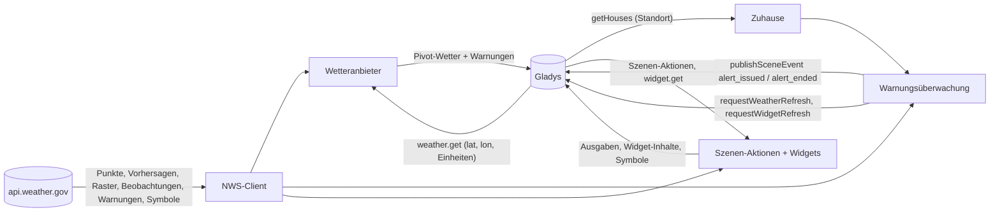
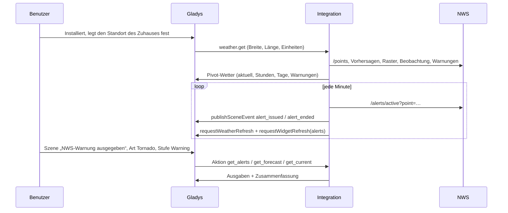
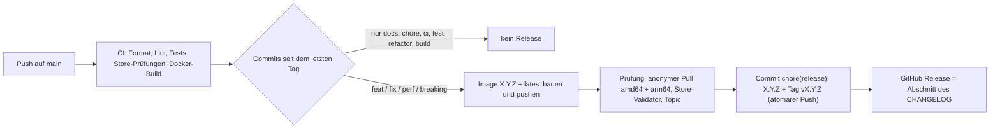

# Gladys National Weather Service

[English](README.md) · [Français](README.fr.md) · **Deutsch** · [Español](README.es.md)

[](LICENSE)
[](https://github.com/William-De71/gladys-national-weather-service/releases)
[](https://github.com/William-De71/gladys-national-weather-service/actions/workflows/release.yml)
[](https://gladysassistant.com)


Externe Integration für [Gladys Assistant](https://gladysassistant.com), die die Vorhersagen des **National Weather
Service**, seine offiziellen **Vorwarnungen, Warnungen und Hinweise**, von Warnungen ausgelöste **Szenen** und
**Dashboard-Widgets** für Zuhause in den Vereinigten Staaten liefert. Gebaut auf
`@gladysassistant/integration-sdk` 0.15.

**Keine Konfiguration**: Die API des NWS (`api.weather.gov`) ist kostenlos und braucht keinen Schlüssel.
Installiere die Integration, und sie funktioniert.


Benutzerdokumentation: [English](docs/en.md) · [Français](docs/fr.md) · [Deutsch](docs/de.md) ·
[Español](docs/es.md).

> Community-Integration, nicht mit dem National Weather Service oder der NOAA verbunden und nicht von ihnen
> unterstützt.

## Inhalt

- [Funktionen](#funktionen)
- [Architektur](#architektur)
- [Installation](#installation)
- [Konfiguration](#konfiguration)
- [Wetteranbieter](#wetteranbieter)
- [Warnungen und Szenen](#warnungen-und-szenen)
- [Dashboard-Widgets](#dashboard-widgets)
- [Aufrufe an den NWS](#aufrufe-an-den-nws)
- [Entwicklung](#entwicklung)
- [Release und Commit-Konvention](#release-und-commit-konvention)
- [Fehlerbehebung](#fehlerbehebung)
- [Mitwirken](#mitwirken)
- [Lizenz](#lizenz)

## Funktionen

- **Wetteranbieter** (Manifest `type: "weather"`): aktuelle Bedingungen, Vorhersagen für 24 Stunden und 7 Tage,
  Sonnenauf- und -untergang und die offiziellen Warnungen, für das Wetter-Widget des Dashboards, den Assistenten und
  die Wetterwarnungs-Auslöser des Kerns.
- **Warnungen in unter einer Minute**: Die Warnungen jedes Zuhauses mit Standort werden jede Minute geprüft
  (einstellbar), und Gladys wird bei jeder Änderung benachrichtigt.
- **Szenen-Auslöser** `alert_issued` und `alert_ended`, gefiltert nach Zuhause, Art der Warnung (Tornado, Hurrikan,
  Hochwasser, Hitze…), Stufe (warning, watch, advisory) und Schweregrad.
- **Szenen-Aktionen** `get_alerts`, `get_forecast`, `get_current`, jeweils mit einem fertigen Satz `summary`.
- **Dashboard-Widgets** `alerts`, `forecast` (der Text des Meteorologen) und `hourly` (Kurven).
- **Transport**: `cloud` (in Gladys unter „Cloud“ eingeordnet): Die Daten kommen von den Servern des NWS.
- **Sprachen**: Englisch, Französisch, Deutsch und Spanisch (Manifest, Widgets, Szenentexte, Dokumentation). Der
  NWS schreibt nur auf Englisch: Ereignisnamen, Vorhersage- und Warnungstexte bleiben auf Englisch.

## Architektur




Von der Installation bis zur Szene:



Eine Wetter-Integration hat keine Geräte: keine Erkennung, keine Zustände, keine Abfrage durch den Kern.

## Installation

In Gladys: **Integrationen → Store → National Weather Service → Installieren**. Lege den Standort jedes Zuhauses
fest (**Einstellungen → Zuhause**). Gladys nutzt die Integration dann als Wetteranbieter für die Zuhause in den
Vereinigten Staaten und greift anderswo auf den nächsten Anbieter zurück. Siehe die
[Benutzerdokumentation](docs/de.md).

Docker-Image: `ghcr.io/william-de71/gladys-national-weather-service`, Multi-Arch (amd64/arm64), ohne Root,
schreibgeschütztes Dateisystem, OCI-Labels und das Manifest im Label `io.gladysassistant.manifest`.

## Konfiguration

Alles optional:

| Schlüssel              | Typ      | Standard | Rolle                                                                                               |
| ---------------------- | -------- | -------- | --------------------------------------------------------------------------------------------------- |
| `contact`              | `string` | —        | wird dem vom NWS verlangten `User-Agent` hinzugefügt, damit er dich vor einer Sperre erreichen kann |
| `cache_duration`       | `number` | 600      | wie lange eine Vorhersage wiederverwendet wird, in Sekunden (0–3600)                                |
| `alert_check_interval` | `number` | 60       | wie oft die Warnungen der Zuhause geprüft werden, in Sekunden (30–900)                              |

Interne Schlüssel (außerhalb des Schemas): `last_language` und `last_units`, Sprache und Einheitensystem der letzten
Anfrage, die die Szenentexte nach einem Neustart verwenden.

**Standort der Zuhause.** Das Wetter erhält seine Koordinaten von Gladys. Die Warnungsüberwachung, die
Szenen-Aktionen und die Widgets lesen die Zuhause von Gladys (`location: true`). Ein Feld „Zuhause“ erwartet den
Namen genau wie in Gladys, mit Groß-/Kleinschreibung — so vergleicht der Kern den Filter des Auslösers, Aktionen und
Widgets tun es ebenso; leer bedeutet alle Zuhause (Auslöser) oder das erste Zuhause mit Standort (Aktionen, Widgets).

## Wetteranbieter

Gladys fragt das Wetter eines Zuhauses an; die Integration antwortet im Pivot-Format (Spezifikation B.18). Vier
Produkte des NWS werden kombiniert, jedes für das, was es am besten kann:

- **Aktuelle Bedingungen**: die letzte Beobachtung der nächsten Station (Temperatur, Luftfeuchtigkeit, Taupunkt,
  Luftdruck, Wind, Böen, Sichtweite, gefühlte Temperatur). Eine Station, die seit 2 Stunden nichts gemeldet hat
  oder keine Temperatur liefert, wird durch die nächste ersetzt; ohne Station gilt die Vorhersage der laufenden
  Stunde.
- **Stündliche Vorhersage** (nächste 24 Stunden): Temperatur, gefühlte Temperatur, Luftfeuchtigkeit, Bewölkung,
  Wind (Geschwindigkeit, Böen, Richtung), Niederschlagsmenge und -wahrscheinlichkeit — die Textvorhersage, ergänzt
  um das Rohraster.
- **Tägliche Vorhersage** (6–7 Tage): Höchstwert des Tages und Tiefstwert der folgenden Nacht (wie der NWS sie
  paart), Himmel, Regenwahrscheinlichkeit, Menge, Wind und Böen.
- **Sonnenauf- und -untergang**: lokal berechnet (die API des NWS veröffentlicht keine); sie steuern auch die
  Tag-/Nacht-Symbole.
- **Einheiten**: metrisch oder US, wie Gladys fragt. Kein UV-Index: die API des NWS veröffentlicht keinen.
- **Warnungen** im CAP-Format, dem von Gladys: Schweregrad und Ereignisname wie veröffentlicht, für den Kern
  typisiert (Tornado → Gewitter, Hurrikan → Wind, Hochwasser, Schnee, Hitze, Kälte, Nebel, Küste…), mit
  Überschrift, Beschreibung und Verhaltenshinweisen.

**Abdeckung**: die Vereinigten Staaten und ihre Territorien (Alaska, Hawaii, Puerto Rico, Guam…). Anderswo antwortet
`/points` mit 404: Die Wetteranfrage schlägt mit `OutOfCoverageError` fehl und Gladys nutzt den nächsten
Wetteranbieter; die Widgets zeigen eine erklärende Meldung; die Warnungsüberwachung überspringt das Zuhause für
einen Tag.

## Warnungen und Szenen

### Auslöser

| Auslöser                                    | Löst aus, wenn…                                                                     | Filter                                           |
| ------------------------------------------- | ----------------------------------------------------------------------------------- | ------------------------------------------------ |
| **NWS-Warnung ausgegeben** (`alert_issued`) | eine neue Vorwarnung, Warnung oder ein Hinweis das Zuhause betrifft (Updates nicht) | Zuhause, Art (13 Kategorien), Stufe, Schweregrad |
| **NWS-Warnung beendet** (`alert_ended`)     | eine Warnung abgelaufen ist oder aufgehoben wurde                                   | Zuhause, Art, Stufe                              |

Arten: Tornado, Hurrikan / tropisch, schweres Gewitter, Hochwasser, Wintersturm, Kälte, Hitze, Wind, Brandgefahr,
Nebel, Luftqualität, Meer, Sonstiges. Stufen: warning, watch, advisory, statement, other. Variablen: Ereignis, Art,
Stufe, Schweregrad, Dringlichkeit, Gewissheit, Überschrift, Gebiet, Beginn und Ende (Ortszeit),
Verhaltenshinweise, Beschreibung, Zusammenfassung.

Beispiel: Auslöser **NWS-Warnung ausgegeben**, Art **Tornado**, Stufe **Warning** → eine Nachricht mit
`{{triggerEvent.data.summary}}` und `{{triggerEvent.data.instruction}}` senden, alle Lichter einschalten.

Eine Warnung wird über ihre Aktualisierungen hinweg verfolgt (der NWS gibt eine neue Warnung aus, die auf die
ersetzte verweist); ein Wechsel zu einem anderen Ereignis (Watch → Warning) beendet die alte und gibt die neue aus;
eine Warnung endet nach ihrer Endzeit oder wenn sie bei zwei aufeinanderfolgenden Prüfungen und 5 Minuten lang
fehlt, und löst „ausgegeben“ erneut aus, wenn sie zurückkehrt (ausgegeben und beendet kommen immer paarweise); die
erste Prüfung nach einem Start dient als Referenz. Eine VTEC-Warnung ohne `ends` (Flood Warning eines Flusses) gilt
bis auf Weiteres: ihr `expires` ist nur der Zeitpunkt der nächsten Meldung.

### Aktionen

| Aktion                                                  | Ausgaben                                                                                                                                             |
| ------------------------------------------------------- | ---------------------------------------------------------------------------------------------------------------------------------------------------- |
| **NWS-Warnungen abrufen** (`get_alerts`)                | Anzahl, Warnings / Watches / Advisories, Ereignisse, die schwerste (Ereignis, Art, Stufe, Schweregrad, Überschrift, Hinweise, Ende), Zusammenfassung |
| **NWS-Vorhersage eines Tages abrufen** (`get_forecast`) | heute bis Tag 6: Höchst- und Tiefstwert, Himmel, Regenwahrscheinlichkeit, Wind, Texte des Meteorologen (Tag und Nacht), Zusammenfassung              |
| **Aktuelle NWS-Bedingungen abrufen** (`get_current`)    | Temperatur, gefühlt, Luftfeuchtigkeit, Taupunkt, Luftdruck, Wind, Böen, Sichtweite, Himmel, Station, Zusammenfassung                                 |

Beispiel: jeden Morgen um 7:00 **NWS-Vorhersage eines Tages abrufen** (Tag: heute), dann ihre `summary` senden
(„Wetter heute in Zuhause: Leicht bewölkt, Höchstwert 29°C, Tiefstwert 17°C, 40 % Regenwahrscheinlichkeit.“).

Die Szenentexte folgen der Sprache der letzten Anfrage von Gladys (Widget oder Wetter), die über Neustarts hinweg
gespeichert wird.

## Dashboard-Widgets

| Widget                              | Inhalt                                                                                                                                   |
| ----------------------------------- | ---------------------------------------------------------------------------------------------------------------------------------------- |
| **NWS-Warnungen** (`alerts`)        | Zähler für Warnings / Watches / Advisories, jede Warnung mit vollständigem Text und Hinweisen im Detail; bei jeder Änderung aktualisiert |
| **NWS-Textvorhersage** (`forecast`) | der Text des Meteorologen, Zeitraum für Zeitraum („Heute Nacht“, „Samstag“…), mit den Symbolen des NWS                                   |
| **NWS nächste Stunden** (`hourly`)  | 12, 24 oder 48 Stunden als Kurve: Temperatur und gefühlte Temperatur, Regenwahrscheinlichkeit oder Wind und Böen, Extremwerte markiert   |

Die Symbole des NWS laufen über `onWidgetGetImage`: Ihr Schlüssel kodiert das ganze Symbol (`nws-day-tsraqhi-40`),
sodass nur ein Symbol des NWS abgerufen werden kann, auch nach einem Neustart.

## Aufrufe an den NWS

Jede Anfrage trägt
`User-Agent: gladys-national-weather-service/<version> (https://github.com/William-De71/gladys-national-weather-service[, contact])`.

| Endpunkt                                   | Aufbewahrt       |
| ------------------------------------------ | ---------------- |
| `/points/{lat},{lon}`                      | 24 h             |
| `/gridpoints/…/stations`                   | 24 h             |
| `/stations/{id}/observations/latest`       | Cache (≤ 10 min) |
| `/gridpoints/…/forecast/hourly`            | Cache            |
| `/gridpoints/…/forecast[?units=si]`        | Cache            |
| `/gridpoints/{office}/{x},{y}` (Rohraster) | Cache            |
| `/alerts/active?point={lat},{lon}`         | 60 s             |
| `/icons/…` (Widget-Symbole)                | 24 h             |

Gleichzeitige Aufrufe teilen sich eine Anfrage; ein 5xx- oder Netzwerkfehler wird einmal wiederholt. Vorhersage,
Raster, Beobachtung und Warnungen sind für das Wetter optional: Ihr Ausfall kostet Details, nie die Antwort.

## Entwicklung

```bash
npm install
npm run format:check
npm run lint
npm test            # node --test, echte Antworten des NWS als Fixtures (test/fixtures)
npx github:GladysAssistant/integration-store . --skip-image-check
docker build -t gladys-national-weather-service .
```

Node 22 oder neuer. `npm start` braucht ein laufendes Gladys (das SDK liest `GLADYS_HOST_API_URL`,
`GLADYS_INTEGRATION_TOKEN` und `GLADYS_INTEGRATION_SELECTOR`, vom Supervisor gesetzt). Die Tests greifen nie auf das
Netzwerk zu. Über die Unit-Tests hinaus:

- `test/structure.test.js` vergleicht jeden Schlüssel des Manifests, der Ereignisdaten, der Aktionsausgaben und der
  Symbolschlüssel mit `test/fixtures/discovery.baseline.json` (Version 1.0.0): Bei einem Update geht keine
  Szenen- oder Widget-Einstellung verloren;
- `test/i18n.test.js` prüft die vier Sprachen (Manifest, Laufzeittexte, Dokumentation, READMEs) und validiert jedes
  Widget in jeder Sprache;
- `test/release.test.js` deckt das Release-Skript ab (Version, Changelog, Bump);
- `docs/illustrations/render.sh` erzeugt die Widget-Illustrationen in `docs/assets` aus dem Code der Widgets neu
  (Headless-Chrome, Styles des Gladys-Frontends): nach jeder Änderung an einem Widget erneut ausführen.

Aufbau: siehe [CLAUDE.md](CLAUDE.md). `gladys_version` ist `>=5.1.1` (Wettertyp, Szenen-Auslöser und -Aktionen,
Dashboard-Widgets externer Integrationen).

## Release und Commit-Konvention

Releases laufen automatisch. Jeder Push auf `main` startet den Release-Workflow:



- Commits und PR-Titel folgen den [Conventional Commits](https://www.conventionalcommits.org/), auf Englisch, für
  den Benutzer geschrieben: Sie werden zu den Zeilen des Changelogs. `feat` → Minor, `fix` / `perf` → Patch, `!`
  oder `BREAKING CHANGE:` → Major.
- `CHANGELOG.md` wird beim Release erzeugt: nie von Hand bearbeiten.
- Das Image wird veröffentlicht und geprüft, **bevor** das Manifest auf `main` die neue Version ankündigt.
- Manueller Start (Actions → Release → Run workflow): `release-as` erzwingt eine Version, `dry-run` zeigt nur die
  Version und die Notizen.
- Ein geschützter `main` würde den Release-Commit ablehnen: Erlaube GitHub Actions, die Regel zu umgehen, oder
  nutze das Token einer GitHub App.

## Fehlerbehebung

| Symptom                                               | Wahrscheinliche Ursache                                                                |
| ----------------------------------------------------- | -------------------------------------------------------------------------------------- |
| „Kein Zuhause in Gladys hat einen Standort“           | lege den Standort eines Zuhauses unter Einstellungen → Zuhause fest                    |
| „Außerhalb des Gebiets des National Weather Service“  | das Zuhause liegt nicht in den USA: Gladys nutzt einen anderen Wetteranbieter          |
| Eine nach Zuhause gefilterte Szene löst nie aus       | das Feld Zuhause muss den Namen genau wiedergeben, mit Groß-/Kleinschreibung           |
| Eine Warnung hat nach einem Neustart nichts ausgelöst | beim Start bereits aktive Warnungen dienen absichtlich als Referenz                    |
| Szenentexte in der falschen Sprache                   | sie folgen der letzten Anfrage von Gladys: zeige einmal ein Widget an                  |
| `403` des NWS in den Logs                             | der NWS hat den User-Agent gesperrt: gib die Kontakt-E-Mail an, damit er dich erreicht |

Ausführliche Logs: Umgebungsvariable `DEBUG=gladys-integration-sdk` am Container setzen.

## Mitwirken

Issues und Pull Requests sind willkommen: Fehlerberichte mit der Gladys-Version, der Version der Integration, der
Stadt oder Postleitzahl des Zuhauses und den Logs ([Issue-Vorlagen](.github/ISSUE_TEMPLATE)). Rückmeldungen auch im
[Thread des Gladys-Forums](https://community.gladysassistant.com/t/integration-externe-national-weather-service/11007).
Sicherheitsprobleme: siehe [SECURITY.md](SECURITY.md).

## Lizenz

[Apache-2.0](LICENSE) — siehe [NOTICE](NOTICE). Vorhersagen, Warnungen und Symbole stammen vom National Weather
Service (NOAA), einem Werk der Regierung der Vereinigten Staaten.
