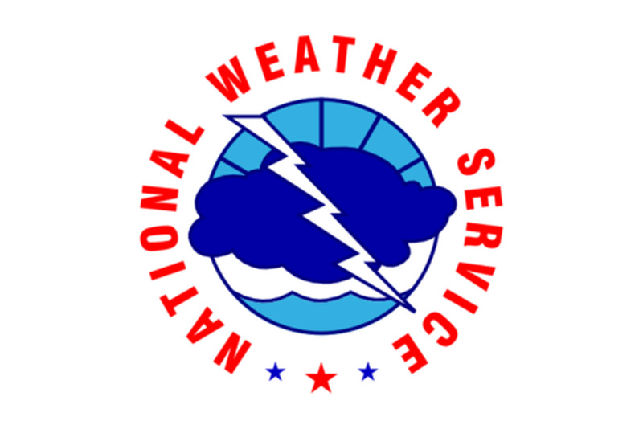
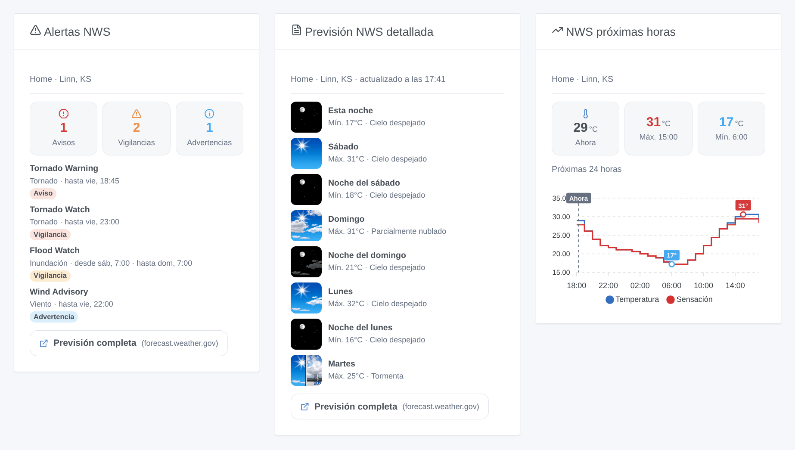
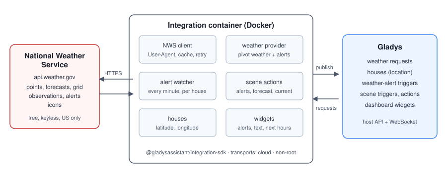
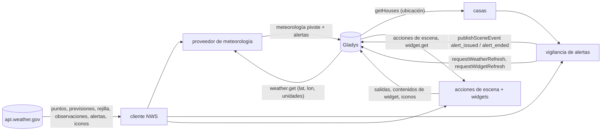
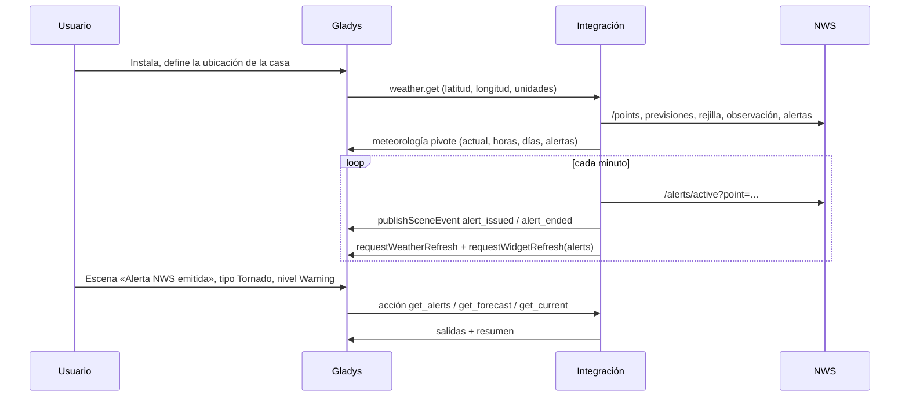
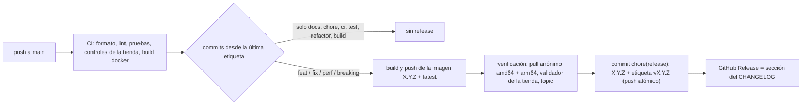

# Gladys National Weather Service

[English](README.md) · [Français](README.fr.md) · [Deutsch](README.de.md) · **Español**

[](LICENSE)
[](https://github.com/William-De71/gladys-national-weather-service/releases)
[](https://github.com/William-De71/gladys-national-weather-service/actions/workflows/release.yml)
[](https://gladysassistant.com)



Integración externa para [Gladys Assistant](https://gladysassistant.com) que aporta las previsiones del **National
Weather Service**, sus **vigilancias, avisos y advertencias** oficiales, **escenas** activadas por las alertas y
**widgets** del panel, para las casas situadas en los Estados Unidos. Construida sobre
`@gladysassistant/integration-sdk` 0.15.

**Ninguna configuración**: la API del NWS (`api.weather.gov`) es gratuita y no necesita clave. Instale la
integración y funciona.



Documentación de usuario: [English](docs/en.md) · [Français](docs/fr.md) · [Deutsch](docs/de.md) ·
[Español](docs/es.md).

> Integración comunitaria, sin relación con el National Weather Service ni con la NOAA, que no la respaldan.

## Índice

- [Funciones](#funciones)
- [Arquitectura](#arquitectura)
- [Instalación](#instalación)
- [Configuración](#configuración)
- [Proveedor de meteorología](#proveedor-de-meteorología)
- [Alertas y escenas](#alertas-y-escenas)
- [Widgets del panel](#widgets-del-panel)
- [Llamadas al NWS](#llamadas-al-nws)
- [Desarrollo](#desarrollo)
- [Release y convención de commits](#release-y-convención-de-commits)
- [Solución de problemas](#solución-de-problemas)
- [Contribuir](#contribuir)
- [Licencia](#licencia)

## Funciones

- **Proveedor de meteorología** (manifiesto `type: "weather"`): condiciones actuales, previsiones a 24 horas y 7
  días, salida y puesta del sol y alertas oficiales, para el widget meteorológico del panel, el asistente y los
  activadores de alerta meteorológica del núcleo.
- **Alertas en menos de un minuto**: las alertas de cada casa con ubicación se comprueban cada minuto (ajustable) y
  se avisa a Gladys en cada cambio.
- **Activadores de escena** `alert_issued` y `alert_ended`, filtrados por casa, tipo de alerta (tornado, huracán,
  inundación, calor…), nivel (warning, watch, advisory) y gravedad.
- **Acciones de escena** `get_alerts`, `get_forecast`, `get_current`, cada una con una frase `summary` lista para
  usar.
- **Widgets** `alerts`, `forecast` (el texto del meteorólogo) y `hourly` (curvas).
- **Transporte**: `cloud` (clasificada en «Nube» en Gladys): los datos vienen de los servidores del NWS.
- **Idiomas**: inglés, francés, alemán y español (manifiesto, widgets, textos de las escenas, documentación). El NWS
  solo escribe en inglés: los nombres de eventos y los textos de previsión y de alerta quedan en inglés.

## Arquitectura





De la instalación a una escena:



Una integración meteorológica no tiene dispositivos: ni descubrimiento, ni estados, ni consultas del núcleo.

## Instalación

Desde Gladys: **Integraciones → tienda → National Weather Service → Instalar**. Defina la ubicación de cada casa
(**Parámetros → Casas**). Gladys la usa entonces como proveedor de meteorología para las casas situadas en los
Estados Unidos, y pasa al siguiente proveedor en otros lugares. Vea la [documentación de usuario](docs/es.md).

Imagen Docker: `ghcr.io/william-de71/gladys-national-weather-service`, multiarquitectura (amd64/arm64), sin root,
sistema de archivos de solo lectura, etiquetas OCI y el manifiesto en la etiqueta `io.gladysassistant.manifest`.

## Configuración

Todo es opcional:

| Clave                  | Tipo     | Defecto | Función                                                                                                    |
| ---------------------- | -------- | ------- | ---------------------------------------------------------------------------------------------------------- |
| `contact`              | `string` | —       | se añade al `User-Agent` que exige el NWS, para que pueda contactarle antes de bloquear un tráfico abusivo |
| `cache_duration`       | `number` | 600     | tiempo de reutilización de una previsión, en segundos (0–3600)                                             |
| `alert_check_interval` | `number` | 60      | frecuencia de comprobación de las alertas de las casas, en segundos (30–900)                               |

Claves internas (fuera del esquema): `last_language` y `last_units`, el idioma y el sistema de unidades de la última
petición, que usan los textos de las escenas tras un reinicio.

**Ubicación de las casas.** La meteorología recibe sus coordenadas de Gladys. La vigilancia de alertas, las acciones
de escena y los widgets leen las casas de Gladys (`location: true`). Un campo «Casa» espera el nombre exactamente
como en Gladys, con mayúsculas — así compara el núcleo el filtro del activador, y las acciones y los widgets hacen lo
mismo; vacío significa todas las casas (activadores) o la primera casa con ubicación (acciones, widgets).

## Proveedor de meteorología

Gladys pide la meteorología de una casa; la integración responde en el formato pivote (especificación B.18). Se
combinan cuatro productos del NWS, cada uno para lo que mejor hace:

- **Condiciones actuales**: la última observación de la estación más cercana (temperatura, humedad, punto de rocío,
  presión, viento, rachas, visibilidad, sensación térmica). Una estación sin datos desde hace 2 horas, o sin
  temperatura, se sustituye por la siguiente; sin ninguna, se usa la previsión de la hora en curso.
- **Previsión por horas** (próximas 24 horas): temperatura, sensación térmica, humedad, nubosidad, viento
  (velocidad, rachas, dirección), cantidad y probabilidad de precipitación — la previsión de texto enriquecida con la
  rejilla bruta.
- **Previsión diaria** (6–7 días): máxima del día y mínima de la noche siguiente (como las empareja el NWS), cielo,
  probabilidad de lluvia, cantidad, viento y rachas.
- **Salida y puesta del sol**: calculadas localmente (la API del NWS no las publica); también rigen los iconos de
  día/noche.
- **Unidades**: métricas o estadounidenses, según pida Gladys. Sin índice UV: la API del NWS no lo publica.
- **Alertas** en formato CAP, el de Gladys: gravedad y nombre del evento tal como se publican, tipadas para el
  núcleo (tornado → tormenta, huracán → viento, inundación, nieve, calor, frío, niebla, costa…), con titular,
  descripción e instrucciones.

**Cobertura**: los Estados Unidos y sus territorios (Alaska, Hawái, Puerto Rico, Guam…). En otros lugares `/points`
responde 404: la petición meteorológica falla con `OutOfCoverageError` y Gladys usa su siguiente proveedor; los
widgets muestran un mensaje explicativo; la vigilancia de alertas omite la casa durante un día.

## Alertas y escenas

### Activadores

| Activador                                 | Se activa cuando…                                                                 | Filtros                                     |
| ----------------------------------------- | --------------------------------------------------------------------------------- | ------------------------------------------- |
| **Alerta NWS emitida** (`alert_issued`)   | una nueva vigilancia, aviso o advertencia cubre la casa (sus actualizaciones, no) | casa, tipo (13 categorías), nivel, gravedad |
| **Fin de una alerta NWS** (`alert_ended`) | una alerta ha expirado o se ha cancelado                                          | casa, tipo, nivel                           |

Tipos: tornado, huracán / tropical, tormenta severa, inundación, tormenta invernal, frío, calor, viento, riesgo de
incendio, niebla, calidad del aire, mar, otro. Niveles: warning, watch, advisory, statement, other. Variables:
evento, tipo, nivel, gravedad, urgencia, certeza, titular, zona, inicio y fin (hora local), instrucciones,
descripción, resumen.

Ejemplo: activador **Alerta NWS emitida**, tipo **Tornado**, nivel **Warning** → enviar un mensaje con
`{{triggerEvent.data.summary}}` y `{{triggerEvent.data.instruction}}`, encender todas las luces.

Una alerta se sigue a través de sus actualizaciones (el NWS emite una nueva alerta que hace referencia a la que
sustituye); un paso a otro evento (Watch → Warning) termina la antigua y emite la nueva; una alerta termina pasada
su hora de fin, o tras faltar en dos comprobaciones seguidas y durante 5 minutos, y vuelve a activar «emitida» si
reaparece (emitida y terminada siempre van en pareja); la primera comprobación tras un arranque sirve de referencia.
Una alerta VTEC sin `ends` (Flood Warning de un río) sigue vigente hasta nuevo aviso: su `expires` solo es la hora
del próximo mensaje.

### Acciones

| Acción                                                   | Salidas                                                                                                                              |
| -------------------------------------------------------- | ------------------------------------------------------------------------------------------------------------------------------------ |
| **Obtener las alertas NWS** (`get_alerts`)               | número, warnings / watches / advisories, eventos, la más grave (evento, tipo, nivel, gravedad, titular, instrucciones, fin), resumen |
| **Obtener la previsión NWS de un día** (`get_forecast`)  | de hoy al día 6: máxima, mínima, cielo, probabilidad de lluvia, viento, textos del meteorólogo (día y noche), resumen                |
| **Obtener las condiciones actuales NWS** (`get_current`) | temperatura, sensación térmica, humedad, punto de rocío, presión, viento, rachas, visibilidad, cielo, estación, resumen              |

Ejemplo: cada mañana a las 7:00, **Obtener la previsión NWS de un día** (día: hoy), y luego enviar su `summary`
(«Tiempo hoy en Casa: parcialmente nublado, máxima 29°C, mínima 17°C, 40 % de probabilidad de lluvia.»).

Los textos de las escenas siguen el idioma de la última petición de Gladys (widget o meteorología), conservado tras
un reinicio.

## Widgets del panel

| Widget                                   | Contenido                                                                                                                                  |
| ---------------------------------------- | ------------------------------------------------------------------------------------------------------------------------------------------ |
| **Alertas NWS** (`alerts`)               | contadores de warnings / watches / advisories, cada alerta con su texto completo e instrucciones en el detalle; actualizado en cada cambio |
| **Previsión NWS detallada** (`forecast`) | el texto del meteorólogo, periodo a periodo («Esta noche», «Sábado»…), con los iconos del NWS                                              |
| **NWS próximas horas** (`hourly`)        | 12, 24 o 48 horas en curva: temperatura y sensación térmica, probabilidad de lluvia, o viento y rachas, extremos anotados                  |

Los iconos del NWS pasan por `onWidgetGetImage`: su clave codifica el icono entero (`nws-day-tsraqhi-40`), de modo
que solo se puede descargar un icono del NWS, también tras un reinicio.

## Llamadas al NWS

Cada petición lleva
`User-Agent: gladys-national-weather-service/<version> (https://github.com/William-De71/gladys-national-weather-service[, contact])`.

| Punto de acceso                                | Conservado       |
| ---------------------------------------------- | ---------------- |
| `/points/{lat},{lon}`                          | 24 h             |
| `/gridpoints/…/stations`                       | 24 h             |
| `/stations/{id}/observations/latest`           | caché (≤ 10 min) |
| `/gridpoints/…/forecast/hourly`                | caché            |
| `/gridpoints/…/forecast[?units=si]`            | caché            |
| `/gridpoints/{office}/{x},{y}` (rejilla bruta) | caché            |
| `/alerts/active?point={lat},{lon}`             | 60 s             |
| `/icons/…` (iconos de los widgets)             | 24 h             |

Las llamadas simultáneas comparten una petición; un fallo 5xx o de red se reintenta una vez. Previsión, rejilla,
observación y alertas son opcionales para la meteorología: su fallo cuesta detalle, nunca la respuesta.

## Desarrollo

```bash
npm install
npm run format:check
npm run lint
npm test            # node --test, respuestas reales del NWS como fixtures (test/fixtures)
npx github:GladysAssistant/integration-store . --skip-image-check
docker build -t gladys-national-weather-service .
```

Node 22 o posterior. `npm start` necesita un Gladys en marcha (el SDK lee `GLADYS_HOST_API_URL`,
`GLADYS_INTEGRATION_TOKEN` y `GLADYS_INTEGRATION_SELECTOR`, definidos por el supervisor). Las pruebas nunca acceden
a la red. Además de las pruebas unitarias:

- `test/structure.test.js` compara cada clave del manifiesto, de los datos de evento, de las salidas de acción y de
  las claves de icono con `test/fixtures/discovery.baseline.json` (versión 1.0.0): ningún ajuste de escena o de
  widget se pierde en una actualización;
- `test/i18n.test.js` comprueba los cuatro idiomas (manifiesto, textos de ejecución, documentación, README) y valida
  cada widget en cada uno;
- `test/release.test.js` cubre el script de release (versión, changelog, bump);
- `docs/illustrations/render.sh` regenera las ilustraciones de los widgets de `docs/assets` a partir de su código
  (Chrome headless, estilos del front de Gladys): vuelva a ejecutarlo tras cualquier cambio de un widget.

Organización: vea [CLAUDE.md](CLAUDE.md). `gladys_version` es `>=5.1.1` (tipo meteorología, activadores y acciones
de escena, widgets de las integraciones externas).

## Release y convención de commits

Las releases son automáticas. Cada push a `main` lanza el workflow Release:



- Los commits y títulos de PR siguen los [Conventional Commits](https://www.conventionalcommits.org/), en inglés,
  escritos para el usuario: se convierten en las líneas del changelog. `feat` → minor, `fix` / `perf` → patch, `!`
  o `BREAKING CHANGE:` → major.
- `CHANGELOG.md` se genera en la release: no lo edite nunca a mano.
- La imagen se publica y se verifica **antes** de que el manifiesto de `main` anuncie la nueva versión.
- Lanzamiento manual (Actions → Release → Run workflow): `release-as` fuerza una versión, `dry-run` solo muestra la
  versión y las notas.
- Una rama `main` protegida rechazaría el commit de release: permita que GitHub Actions omita la regla, o use el
  token de una GitHub App.

## Solución de problemas

| Síntoma                                              | Causa probable                                                                         |
| ---------------------------------------------------- | -------------------------------------------------------------------------------------- |
| «Ninguna casa de Gladys tiene ubicación»             | defina la ubicación de una casa en Parámetros → Casas                                  |
| «Fuera de la cobertura del National Weather Service» | la casa no está en los Estados Unidos: Gladys usa otro proveedor de meteorología       |
| Una escena filtrada por casa nunca se activa         | el campo Casa debe reproducir el nombre exacto, con mayúsculas                         |
| Una alerta no activó nada tras un reinicio           | las alertas ya en vigor al arrancar sirven de referencia, a propósito                  |
| Textos de las escenas en el idioma equivocado        | siguen la última petición de Gladys: muestre un widget una vez                         |
| `403` del NWS en los logs                            | el NWS bloqueó el User-Agent: indique el correo de contacto para que pueda localizarle |

Logs detallados: variable de entorno `DEBUG=gladys-integration-sdk` en el contenedor.

## Contribuir

Issues y pull requests son bienvenidos: informes de errores con la versión de Gladys, la de la integración, la
ciudad o el código postal de la casa y los logs ([plantillas de issue](.github/ISSUE_TEMPLATE)). Comentarios también
en el [hilo del foro de Gladys](https://community.gladysassistant.com/t/integration-externe-national-weather-service/11007).
Problemas de seguridad: vea [SECURITY.md](SECURITY.md).

## Licencia

[Apache-2.0](LICENSE) — vea [NOTICE](NOTICE). Las previsiones, alertas e iconos proceden del National Weather
Service (NOAA), una obra del gobierno de los Estados Unidos.
