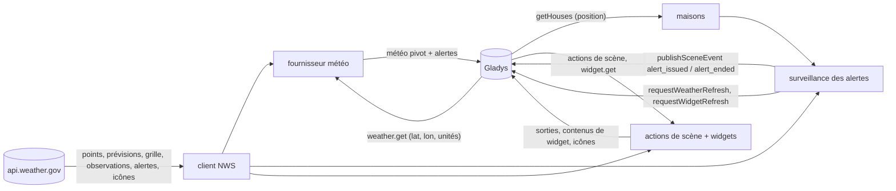
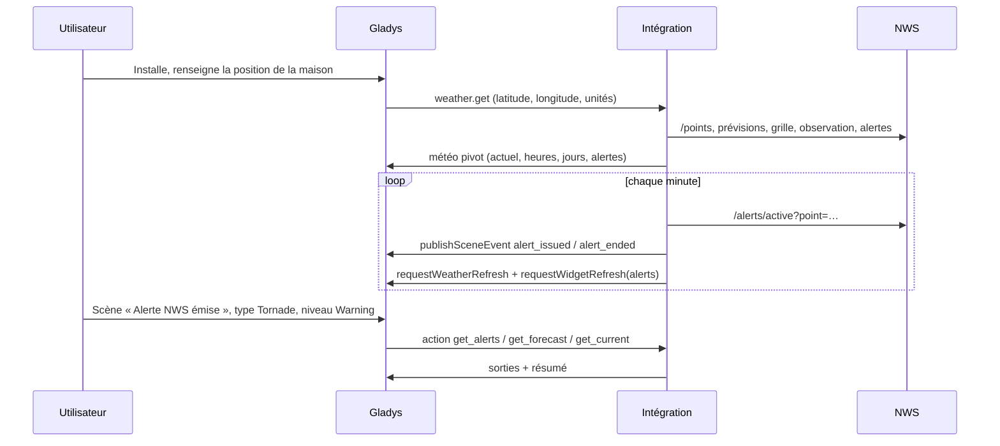
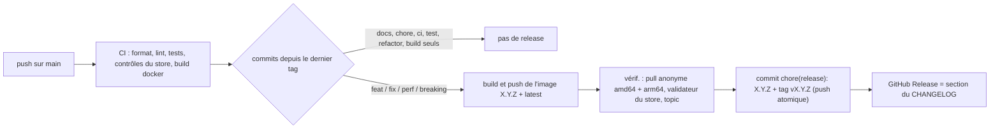

# Gladys National Weather Service

[English](README.md) · **Français** · [Deutsch](README.de.md) · [Español](README.es.md)

[](LICENSE)
[](https://github.com/William-De71/gladys-national-weather-service/releases)
[](https://github.com/William-De71/gladys-national-weather-service/actions/workflows/release.yml)
[](https://gladysassistant.com)


Intégration externe pour [Gladys Assistant](https://gladysassistant.com) qui apporte les prévisions du **National
Weather Service**, ses **veilles, alertes et avis** officiels, des **scènes** déclenchées par les alertes et des
**widgets** de tableau de bord, pour les maisons situées aux États-Unis. Construite sur
`@gladysassistant/integration-sdk` 0.15.

**Aucune configuration** : l'API du NWS (`api.weather.gov`) est gratuite et sans clé. Installez l'intégration, elle
fonctionne.


Documentation utilisateur : [English](docs/en.md) · [Français](docs/fr.md) · [Deutsch](docs/de.md) ·
[Español](docs/es.md).

> Intégration communautaire, sans lien avec le National Weather Service ni la NOAA, qui ne l'approuvent pas.

## Sommaire

- [Fonctionnalités](#fonctionnalités)
- [Architecture](#architecture)
- [Installation](#installation)
- [Configuration](#configuration)
- [Fournisseur météo](#fournisseur-météo)
- [Alertes et scènes](#alertes-et-scènes)
- [Widgets du tableau de bord](#widgets-du-tableau-de-bord)
- [Appels au NWS](#appels-au-nws)
- [Développement](#développement)
- [Release et convention de commits](#release-et-convention-de-commits)
- [Dépannage](#dépannage)
- [Contribuer](#contribuer)
- [Licence](#licence)

## Fonctionnalités

- **Fournisseur météo** (manifeste `type: "weather"`) : conditions actuelles, prévisions sur 24 heures et 7 jours,
  lever et coucher du soleil et alertes officielles, pour le widget météo du tableau de bord, l'assistant et les
  déclencheurs « Alerte météo » du cœur.
- **Alertes en moins d'une minute** : les alertes de chaque maison localisée sont vérifiées chaque minute (réglable)
  et Gladys est prévenu à chaque changement.
- **Déclencheurs de scène** `alert_issued` et `alert_ended`, filtrés par maison, type d'alerte (tornade, ouragan,
  inondation, chaleur…), niveau (warning, watch, advisory) et sévérité.
- **Actions de scène** `get_alerts`, `get_forecast`, `get_current`, chacune avec une phrase `summary` prête à
  l'emploi.
- **Widgets** `alerts`, `forecast` (le texte du prévisionniste) et `hourly` (courbes).
- **Transport** : `cloud` (rangée sous « Cloud » dans Gladys) : les données viennent des serveurs du NWS.
- **Langues** : anglais, français, allemand et espagnol (manifeste, widgets, textes des scènes, docs). Le NWS
  n'écrit qu'en anglais : noms d'événements, textes de prévision et d'alerte restent en anglais.

## Architecture




De l'installation à une scène :



Une intégration météo n'a pas d'appareils : ni découverte, ni états, ni interrogation par le cœur.

## Installation

Depuis Gladys : **Intégrations → store → National Weather Service → Installer**. Renseignez la position de chaque
maison (**Paramètres → Maisons**). Gladys l'utilise alors comme fournisseur météo pour les maisons situées aux
États-Unis, et passe au fournisseur suivant ailleurs. Voir la [documentation utilisateur](docs/fr.md).

Image Docker : `ghcr.io/william-de71/gladys-national-weather-service`, multi-arch (amd64/arm64), non-root, système de
fichiers en lecture seule, labels OCI et manifeste dans le label `io.gladysassistant.manifest`.

## Configuration

Tout est facultatif :

| Clé                    | Type     | Défaut | Rôle                                                                                              |
| ---------------------- | -------- | ------ | ------------------------------------------------------------------------------------------------- |
| `contact`              | `string` | —      | ajouté au `User-Agent` exigé par le NWS, pour qu'il puisse vous prévenir avant de bloquer un abus |
| `cache_duration`       | `number` | 600    | durée de réutilisation d'une prévision, en secondes (0–3600)                                      |
| `alert_check_interval` | `number` | 60     | fréquence de vérification des alertes des maisons, en secondes (30–900)                           |

Clés internes (hors schéma) : `last_language` et `last_units`, la langue et le système d'unités de la dernière
requête, utilisés par les textes des scènes après un redémarrage.

**Position des maisons.** La météo reçoit ses coordonnées de Gladys. La surveillance des alertes, les actions de
scène et les widgets lisent les maisons de Gladys (`location: true`). Un champ « Maison » prend le nom de la maison
exactement comme dans Gladys, majuscules comprises — c'est ainsi que le cœur compare le filtre du déclencheur, les
actions et les widgets font de même ; vide signifie toutes les maisons (déclencheurs) ou la première maison
localisée (actions, widgets).

## Fournisseur météo

Gladys demande la météo d'une maison ; l'intégration répond au format pivot (spec B.18). Quatre produits du NWS sont
combinés, chacun pour ce qu'il fait le mieux :

- **Conditions actuelles** : la dernière observation de la station la plus proche (température, humidité, point de
  rosée, pression, vent, rafales, visibilité, ressenti). Une station muette depuis 2 heures, ou sans température,
  est remplacée par la suivante ; à défaut, la prévision de l'heure en cours est utilisée.
- **Prévision horaire** (24 prochaines heures) : température, ressenti, humidité, nébulosité, vent (vitesse,
  rafales, direction), quantité et probabilité de précipitations — la prévision texte enrichie de la grille brute.
- **Prévision journalière** (6 à 7 jours) : maximum de la journée et minimum de la nuit suivante (comme le NWS les
  associe), ciel, risque de pluie, cumul, vent et rafales.
- **Lever et coucher du soleil** : calculés localement (l'API du NWS n'en publie pas) ; ils pilotent aussi les
  icônes jour/nuit.
- **Unités** : métriques ou américaines, selon la demande de Gladys. Pas d'indice UV : l'API du NWS n'en publie pas.
- **Alertes** au format CAP, celui de Gladys : sévérité et nom de l'événement tels que publiés, typés pour le cœur
  (tornade → orage, ouragan → vent, inondation, neige, chaleur, froid, brouillard, littoral…), avec titre,
  description et consignes.

**Couverture** : les États-Unis et leurs territoires (Alaska, Hawaï, Porto Rico, Guam…). Ailleurs, `/points` répond
404 : la requête météo échoue avec `OutOfCoverageError` et Gladys passe au fournisseur suivant ; les widgets
affichent un message explicatif ; la surveillance des alertes ignore la maison pendant une journée.

## Alertes et scènes

### Déclencheurs

| Déclencheur                              | Se déclenche quand…                                                             | Filtres                                        |
| ---------------------------------------- | ------------------------------------------------------------------------------- | ---------------------------------------------- |
| **Alerte NWS émise** (`alert_issued`)    | une nouvelle veille, alerte ou un avis couvre la maison (ses mises à jour, non) | maison, type (13 catégories), niveau, sévérité |
| **Fin d'une alerte NWS** (`alert_ended`) | une alerte a expiré ou a été annulée                                            | maison, type, niveau                           |

Types : tornade, ouragan / tropical, orage violent, inondation, tempête hivernale, froid, chaleur, vent, risque
d'incendie, brouillard, qualité de l'air, mer, autre. Niveaux : warning, watch, advisory, statement, other.
Variables : événement, type, niveau, sévérité, urgence, certitude, titre, zone, début et fin (heure locale),
consignes, description, résumé.

Exemple : déclencheur **Alerte NWS émise**, type **Tornade**, niveau **Warning** → envoyer un message avec
`{{triggerEvent.data.summary}}` et `{{triggerEvent.data.instruction}}`, allumer toutes les lumières.

Une alerte est suivie à travers ses mises à jour (le NWS émet une nouvelle alerte qui référence celle qu'elle
remplace) ; un passage à un autre événement (Watch → Warning) termine l'ancienne et émet la nouvelle ; une alerte se
termine passé son heure de fin, ou après deux vérifications consécutives et 5 minutes d'absence, et redéclenche
« émise » si elle revient (émise et terminée vont toujours par paire) ; la première vérification après un démarrage
sert de référence. Une alerte VTEC sans `ends` (Flood Warning d'une rivière) court jusqu'à nouvel ordre : son
`expires` n'est que l'heure du prochain message.

### Actions

| Action                                                   | Sorties                                                                                                                               |
| -------------------------------------------------------- | ------------------------------------------------------------------------------------------------------------------------------------- |
| **Obtenir les alertes NWS** (`get_alerts`)               | nombre, warnings / watches / advisories, événements, la plus grave (événement, type, niveau, sévérité, titre, consignes, fin), résumé |
| **Obtenir la prévision NWS d'un jour** (`get_forecast`)  | d'aujourd'hui à J+6 : maximum, minimum, ciel, risque de pluie, vent, textes du prévisionniste (jour et nuit), résumé                  |
| **Obtenir les conditions actuelles NWS** (`get_current`) | température, ressenti, humidité, point de rosée, pression, vent, rafales, visibilité, ciel, station, résumé                           |

Exemple : chaque matin à 7 h, **Obtenir la prévision NWS d'un jour** (jour : aujourd'hui), puis envoyer son
`summary` (« Météo aujourd'hui à Maison : éclaircies, max 29°C, min 17°C, 40 % de risque de pluie. »).

Les textes des scènes suivent la langue de la dernière requête de Gladys (widget ou météo), conservée après un
redémarrage.

## Widgets du tableau de bord

| Widget                                   | Contenu                                                                                                                                         |
| ---------------------------------------- | ----------------------------------------------------------------------------------------------------------------------------------------------- |
| **Alertes NWS** (`alerts`)               | compteurs warnings / watches / advisories, chaque alerte avec son texte complet et ses consignes dans le détail ; rafraîchi à chaque changement |
| **Prévision NWS détaillée** (`forecast`) | le texte du prévisionniste, période par période (« Cette nuit », « Samedi »…), avec les icônes du NWS                                           |
| **NWS heure par heure** (`hourly`)       | 12, 24 ou 48 heures en courbe : température et ressenti, risque de pluie, ou vent et rafales, extrêmes annotés                                  |

Les icônes du NWS passent par `onWidgetGetImage` : leur clé encode l'icône entière (`nws-day-tsraqhi-40`), si bien
que seule une icône du NWS peut être téléchargée, y compris après un redémarrage.

## Appels au NWS

Chaque requête porte
`User-Agent: gladys-national-weather-service/<version> (https://github.com/William-De71/gladys-national-weather-service[, contact])`.

| Point d'accès                                 | Conservé         |
| --------------------------------------------- | ---------------- |
| `/points/{lat},{lon}`                         | 24 h             |
| `/gridpoints/…/stations`                      | 24 h             |
| `/stations/{id}/observations/latest`          | cache (≤ 10 min) |
| `/gridpoints/…/forecast/hourly`               | cache            |
| `/gridpoints/…/forecast[?units=si]`           | cache            |
| `/gridpoints/{office}/{x},{y}` (grille brute) | cache            |
| `/alerts/active?point={lat},{lon}`            | 60 s             |
| `/icons/…` (icônes des widgets)               | 24 h             |

Les appels simultanés partagent une requête ; un échec 5xx ou réseau est retenté une fois. Prévisions, grille,
observation et alertes sont facultatives pour la météo : leur échec coûte du détail, jamais la réponse.

## Développement

```bash
npm install
npm run format:check
npm run lint
npm test            # node --test, vraies réponses du NWS en fixtures (test/fixtures)
npx github:GladysAssistant/integration-store . --skip-image-check
docker build -t gladys-national-weather-service .
```

Node 22 ou plus. `npm start` demande un Gladys en marche (le SDK lit `GLADYS_HOST_API_URL`,
`GLADYS_INTEGRATION_TOKEN` et `GLADYS_INTEGRATION_SELECTOR`, fournis par le superviseur). Les tests n'accèdent
jamais au réseau. Au-delà des tests unitaires :

- `test/structure.test.js` compare chaque clé du manifeste, des données d'événement, des sorties d'action et des
  clés d'icône à `test/fixtures/discovery.baseline.json` (version 1.0.0) : aucun réglage de scène ou de widget n'est
  perdu lors d'une mise à jour ;
- `test/i18n.test.js` vérifie les quatre langues (manifeste, textes d'exécution, docs, README) et valide chaque
  widget dans chacune ;
- `test/release.test.js` couvre le script de release (version, changelog, bump) ;
- `docs/illustrations/render.sh` régénère les illustrations des widgets de `docs/assets` à partir de leur code
  (Chrome headless, styles du front Gladys) : à relancer après tout changement d'un widget.

Organisation : voir [CLAUDE.md](CLAUDE.md). `gladys_version` vaut `>=5.3.0` (type météo, déclencheurs et actions
de scène, widgets des intégrations externes, mots-clés et pays du catalogue de Gladys 5.3).

## Release et convention de commits

Les releases sont automatiques. Chaque push sur `main` lance le workflow Release :



- Commits et titres de PR suivent les [Conventional Commits](https://www.conventionalcommits.org/), en anglais,
  écrits pour l'utilisateur : ils deviennent les lignes du changelog. `feat` → minor, `fix` / `perf` → patch, `!`
  ou `BREAKING CHANGE:` → major.
- `CHANGELOG.md` est généré à la release : ne jamais l'éditer à la main.
- L'image est publiée et vérifiée **avant** que le manifeste de `main` n'annonce la nouvelle version.
- Lancement manuel (Actions → Release → Run workflow) : `release-as` force une version, `dry-run` affiche seulement
  la version et les notes.
- Une branche `main` protégée refuserait le commit de release : autorisez GitHub Actions à contourner la règle, ou
  utilisez le jeton d'une GitHub App.

## Dépannage

| Symptôme                                             | Cause probable                                                                       |
| ---------------------------------------------------- | ------------------------------------------------------------------------------------ |
| « Aucune maison de Gladys n'est localisée »          | renseignez la position d'une maison dans Paramètres → Maisons                        |
| « Hors de la zone du National Weather Service »      | la maison n'est pas aux États-Unis : Gladys utilise un autre fournisseur météo       |
| Une scène filtrée sur une maison ne se déclenche pas | le champ Maison doit reprendre le nom exact de la maison, majuscules comprises       |
| Une alerte n'a rien déclenché après un redémarrage   | les alertes déjà en cours au démarrage servent de référence, volontairement          |
| Textes des scènes dans la mauvaise langue            | ils suivent la dernière requête de Gladys : affichez un widget une fois              |
| `403` du NWS dans les logs                           | le NWS a bloqué le User-Agent : renseignez l'email de contact pour qu'il vous joigne |

Logs détaillés : variable d'environnement `DEBUG=gladys-integration-sdk` sur le conteneur.

## Contribuer

Issues et pull requests bienvenues : rapports de bug avec la version de Gladys, celle de l'intégration, la ville ou
le code postal de la maison et les logs ([modèles d'issue](.github/ISSUE_TEMPLATE)). Retours aussi sur le
[fil du forum Gladys](https://community.gladysassistant.com/t/integration-externe-national-weather-service/11007).
Problèmes de sécurité : voir [SECURITY.md](SECURITY.md).

## Licence

[Apache-2.0](LICENSE) — voir [NOTICE](NOTICE). Les prévisions, alertes et icônes viennent du National Weather
Service (NOAA), une œuvre du gouvernement des États-Unis.
