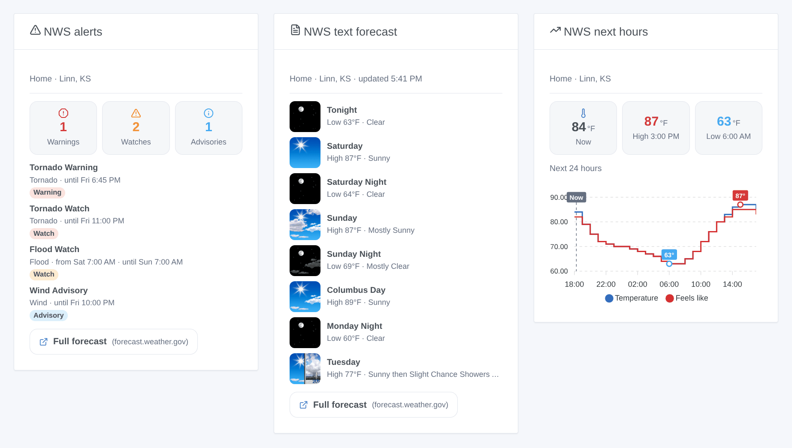
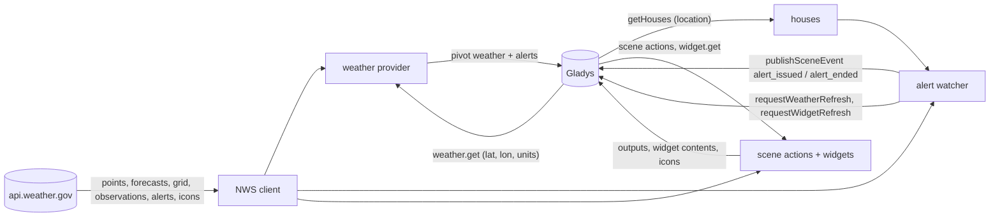
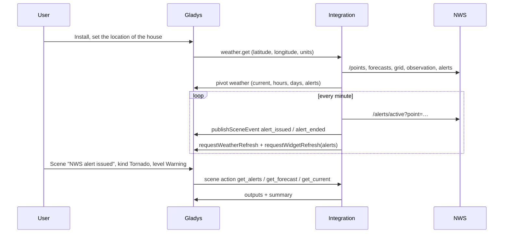
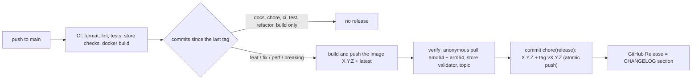

# Gladys National Weather Service

**English** · [Français](README.fr.md) · [Deutsch](README.de.md) · [Español](README.es.md)

[](LICENSE)
[](https://github.com/William-De71/gladys-national-weather-service/releases)
[](https://github.com/William-De71/gladys-national-weather-service/actions/workflows/release.yml)
[](https://gladysassistant.com)


External [Gladys Assistant](https://gladysassistant.com) integration providing **National Weather Service**
forecasts, the official **watches, warnings and advisories**, alert-driven **scenes** and **dashboard widgets** for
houses in the United States, built on `@gladysassistant/integration-sdk` 0.15.

**Zero configuration**: the NWS API (`api.weather.gov`) is free and needs no key. Install the integration and it
works.



User documentation: [English](docs/en.md) · [Français](docs/fr.md) · [Deutsch](docs/de.md) · [Español](docs/es.md).

> Community integration, not affiliated with or endorsed by the National Weather Service or NOAA.

## Contents

- [Features](#features)
- [Architecture](#architecture)
- [Installation](#installation)
- [Configuration](#configuration)
- [Weather provider](#weather-provider)
- [Alerts and scenes](#alerts-and-scenes)
- [Dashboard widgets](#dashboard-widgets)
- [Calls to the NWS](#calls-to-the-nws)
- [Development](#development)
- [Release and commit convention](#release-and-commit-convention)
- [Troubleshooting](#troubleshooting)
- [Contributing](#contributing)
- [License](#license)

## Features

- **Weather provider** (manifest `type: "weather"`): current conditions, 24-hour and 7-day forecasts, sunrise and
  sunset and the official alerts, for the dashboard weather widget, the chat assistant and the core weather-alert
  triggers.
- **Alerts within a minute**: the alerts of every located house are checked every minute (configurable), and Gladys
  is nudged on every change.
- **Scene triggers** `alert_issued` and `alert_ended`, filtered on the house, the kind of alert (tornado,
  hurricane, flood, heat…), its level (warning, watch, advisory) and its severity.
- **Scene actions** `get_alerts`, `get_forecast`, `get_current`, each with a ready-made `summary` sentence.
- **Dashboard widgets** `alerts`, `forecast` (the forecaster's text) and `hourly` (curves).
- **Transport**: `cloud` (listed under "Cloud" in Gladys): the data comes from the NWS servers.
- **Languages**: English, French, German and Spanish (manifest, widgets, scene texts, docs). The NWS writes in
  English only: its event names, narratives and alert texts stay in English.

## Architecture




From the installation to a scene:



A weather integration has no devices: no discovery, no states, no polling by the core.

## Installation

From Gladys: **Integrations → store → National Weather Service → Install**. Set the location of each house
(**Settings → Houses**). Gladys then uses it as its weather provider for the houses in the United States, and falls
through to the next provider elsewhere. See the [user documentation](docs/en.md).

Docker image: `ghcr.io/william-de71/gladys-national-weather-service`, multi-arch (amd64/arm64), non-root, read-only
rootfs, OCI labels and the manifest as the `io.gladysassistant.manifest` label.

## Configuration

All optional:

| Key                    | Type     | Default | Role                                                                                            |
| ---------------------- | -------- | ------- | ----------------------------------------------------------------------------------------------- |
| `contact`              | `string` | —       | added to the `User-Agent` the NWS requires, so it can reach you before blocking abusive traffic |
| `cache_duration`       | `number` | 600     | how long a forecast is reused, in seconds (0–3600)                                              |
| `alert_check_interval` | `number` | 60      | how often the alerts of the houses are checked, in seconds (30–900)                             |

Internal keys (outside the schema): `last_language` and `last_units`, the language and unit system of the last
request, used by the scene texts after a restart.

**House location.** The weather path gets its coordinates from Gladys. The alert watcher, the scene actions and the
widgets read the houses of Gladys (`location: true`). A "House" field takes the house name exactly as shown in
Gladys, case included — the core matches the trigger filter that way, so the actions and widgets do too; empty
means every house (triggers) or the first located house (actions, widgets).

## Weather provider

Gladys asks the weather of a house; the integration answers in the pivot format (spec B.18). Four NWS products are
merged, each for what it does best:

- **Current conditions**: the latest observation of the nearest station (temperature, humidity, dew point,
  pressure, wind, gusts, visibility, feels-like). A station that has not reported for 2 hours, or reports no
  temperature, is skipped for the next one; without any, the forecast of the running hour is used.
- **Hourly forecast** (next 24 hours): temperature, feels-like, humidity, cloud cover, wind speed/gust/direction,
  precipitation amount and probability — the text forecast enriched with the raw forecast grid.
- **Daily forecast** (6–7 days): high of the day period and low of the night that follows (as the NWS pairs them),
  condition, chance of rain, precipitation amount, wind and gusts.
- **Sunrise and sunset**: computed locally (the NWS API publishes none); they also drive the day/night icons.
- **Units**: metric or US, as Gladys asks. No UV index: the NWS API does not publish one.
- **Alerts** in CAP, the format Gladys uses: severity and event name kept as published, typed for the core (tornado
  → thunderstorm, hurricane → wind, flood, snow, heat, cold, fog, coastal…), with headline, description and
  instructions.

**Coverage**: the United States and its territories (Alaska, Hawaii, Puerto Rico, Guam…). Elsewhere `/points`
answers 404: the weather request fails with `OutOfCoverageError` and Gladys uses its next weather provider; the
widgets show an explanatory message; the alert watcher skips the house for a day.

## Alerts and scenes

### Triggers

| Trigger                               | Fires when…                                                              | Filters                                      |
| ------------------------------------- | ------------------------------------------------------------------------ | -------------------------------------------- |
| **NWS alert issued** (`alert_issued`) | a new watch, warning or advisory covers the house (updates don't refire) | house, kind (13 categories), level, severity |
| **NWS alert ended** (`alert_ended`)   | an alert expired or was cancelled                                        | house, kind, level                           |

Kinds: tornado, hurricane / tropical, severe thunderstorm, flood, winter storm, cold, heat, wind, fire weather, fog,
air quality, marine, other. Levels: warning, watch, advisory, statement, other. Variables: event, kind, level,
severity, urgency, certainty, headline, area, start and end (local time), instructions, description, summary.

Example: trigger **NWS alert issued**, kind **Tornado**, level **Warning** → send a message with
`{{triggerEvent.data.summary}}` and `{{triggerEvent.data.instruction}}`, turn every light on.

An alert is followed through its updates (the NWS issues a new alert referencing the one it replaces); an upgrade
to another event (Watch → Warning) ends the old alert and issues the new one; an alert ends past its end time, or
once missing from two checks in a row and for 5 minutes, and fires "issued" again if it comes back (issued and ended
always pair); the first check after a start is a baseline. A VTEC alert with no `ends` (river Flood Warning) runs
until further notice: its `expires` is only the time of the next message.

### Actions

| Action                                             | Outputs                                                                                                                                   |
| -------------------------------------------------- | ----------------------------------------------------------------------------------------------------------------------------------------- |
| **Get the NWS alerts** (`get_alerts`)              | count, warnings / watches / advisories, events, the most serious one (event, kind, level, severity, headline, instructions, end), summary |
| **Get the NWS forecast of a day** (`get_forecast`) | today to day 6: high, low, sky, chance of rain, wind, the forecaster's day and night texts, summary                                       |
| **Get the current NWS conditions** (`get_current`) | temperature, feels-like, humidity, dew point, pressure, wind, gusts, visibility, sky, station, summary                                    |

Example: every morning at 7:00, **Get the NWS forecast of a day** (day: today), then send its `summary` ("Weather
today in Home: partly cloudy, high 84°F, low 63°F, 40% chance of rain.").

The scene texts follow the language of the last request Gladys made (widget or weather), stored across restarts.

## Dashboard widgets

| Widget                             | Content                                                                                                                                 |
| ---------------------------------- | --------------------------------------------------------------------------------------------------------------------------------------- |
| **NWS alerts** (`alerts`)          | warnings / watches / advisories counters, each alert with its full text and instructions in the detail panel; refreshed on every change |
| **NWS text forecast** (`forecast`) | the forecaster's narrative, period by period ("Tonight", "Saturday"…), with the NWS icons                                               |
| **NWS next hours** (`hourly`)      | 12, 24 or 48 hours as a curve: temperature and feels-like, chance of rain, or wind and gusts, extremes annotated                        |

The NWS icons are served through `onWidgetGetImage`: their key encodes the icon whole (`nws-day-tsraqhi-40`), so only
an NWS icon can ever be fetched, after a restart too.

## Calls to the NWS

Every request carries
`User-Agent: gladys-national-weather-service/<version> (https://github.com/William-De71/gladys-national-weather-service[, contact])`.

| Endpoint                                  | Kept             |
| ----------------------------------------- | ---------------- |
| `/points/{lat},{lon}`                     | 24 h             |
| `/gridpoints/…/stations`                  | 24 h             |
| `/stations/{id}/observations/latest`      | cache (≤ 10 min) |
| `/gridpoints/…/forecast/hourly`           | cache            |
| `/gridpoints/…/forecast[?units=si]`       | cache            |
| `/gridpoints/{office}/{x},{y}` (raw grid) | cache            |
| `/alerts/active?point={lat},{lon}`        | 60 s             |
| `/icons/…` (widget icons)                 | 24 h             |

Concurrent calls share one request; a 5xx or network failure is retried once. The forecast, grid, observation and
alerts are optional for the weather payload: their failure costs detail, never the answer.

## Development

```bash
npm install
npm run format:check
npm run lint
npm test            # node --test, real NWS answers as fixtures (test/fixtures)
npx github:GladysAssistant/integration-store . --skip-image-check
docker build -t gladys-national-weather-service .
```

Node 22 or later. `npm start` needs a running Gladys (the SDK reads `GLADYS_HOST_API_URL`,
`GLADYS_INTEGRATION_TOKEN` and `GLADYS_INTEGRATION_SELECTOR`, set by the supervisor). The tests never touch the
network. Beyond the unit tests:

- `test/structure.test.js` compares every key of the manifest, the scene event data, the action outputs and the icon
  keys with `test/fixtures/discovery.baseline.json` (version 1.0.0): no scene or widget setting is lost on an update;
- `test/i18n.test.js` checks the four languages (manifest, runtime texts, docs, READMEs) and validates every widget
  in each;
- `test/release.test.js` covers the release script (version, changelog, bump);
- `docs/illustrations/render.sh` regenerates the widget illustrations of `docs/assets` from the widget code
  (headless Chrome, the Gladys front styles): run it after any change to a widget.

Layout: see [CLAUDE.md](CLAUDE.md). `gladys_version` is `>=5.1.1` (weather type, scene triggers and actions,
dashboard widgets of external integrations).

## Release and commit convention

Releases are automatic. Every push to `main` runs the Release workflow:



- Commits and PR titles follow [Conventional Commits](https://www.conventionalcommits.org/), in English, written
  for the user: they become the changelog lines. `feat` → minor, `fix` / `perf` → patch, `!` or `BREAKING
CHANGE:` → major.
- `CHANGELOG.md` is generated at the release: never edit it by hand.
- The image is published and checked **before** the manifest on `main` announces the new version.
- Manual run (Actions → Release → Run workflow): `release-as` forces a version, `dry-run` only shows the version
  and the notes.
- A protected `main` would reject the release commit: allow GitHub Actions to bypass the rule, or use a GitHub
  App token.

## Troubleshooting

| Symptom                                         | Likely cause                                                                |
| ----------------------------------------------- | --------------------------------------------------------------------------- |
| "No house of Gladys has a location"             | set the location of a house in Settings → Houses                            |
| "Outside the National Weather Service coverage" | the house is not in the United States: Gladys uses another weather provider |
| A scene filtered on a house never fires         | the House field must match the house name exactly, case included            |
| An alert fired nothing after a restart          | alerts already in force at the start are a baseline, on purpose             |
| Scene texts in the wrong language               | they follow the last request of Gladys: display a widget once               |
| `403` from the NWS in the logs                  | the NWS blocked the User-Agent: set the contact email so it can reach you   |

Detailed logs: set the environment variable `DEBUG=gladys-integration-sdk` on the container.

## Contributing

Issues and pull requests are welcome: bug reports with the Gladys version, the integration version, the city or ZIP
code of the house and the logs ([issue templates](.github/ISSUE_TEMPLATE)). Feedback on the
[Gladys forum thread](https://community.gladysassistant.com/t/integration-externe-national-weather-service/11007)
too. Security problems: see [SECURITY.md](SECURITY.md).

## License

[Apache-2.0](LICENSE) — see [NOTICE](NOTICE). The forecasts, alerts and icons come from the National Weather
Service (NOAA), a work of the United States government.
